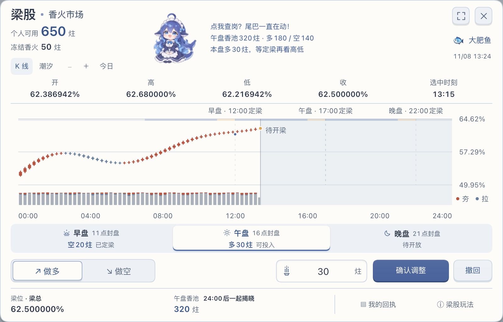
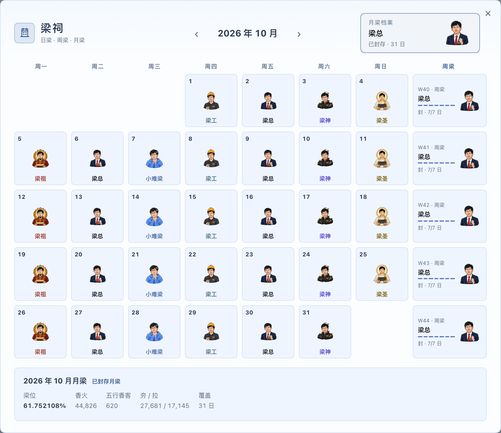

# 梁相

**众香成势，梁子显相。梁相还得梁人出！**

梁相是 [DeepSeek Harness](https://github.com/deepseek-ai/deepseek-harness) 的插件。把对话凝成香火，一炷夯或拉，共同显出今日梁子；也能在梁股做多做空，午夜一起揭晓，日终结果收入梁祠。

独立社区项目，非 DeepSeek 官方产品。

官网：[liang.today](https://liang.today/) · [完整安装指南](https://liang.today/guide/)





*功能示例，香火数据仅作演示。*

## 梁相2.0

- **在线钱包**：香火余额与已到账收益跨日保留，可用与冻结分开看。
- **梁股三盘**：早、午、晚各选多空，封盘前可改可撤，午夜共同揭晓。
- **全新水景**：余香化水，游鱼相伴；熟悉的拍梁子、凝香与倾炉继续保留。

## Desktop：应用内安装（推荐）

1. 打开 DSH Desktop 的 **插件 → 添加插件**。
2. 输入完整包名 **`dsh-liangxiang`**，点击 **安装**。
3. 安装完成后点击 **立即启用**；页面边缘出现“今日梁相”即装好。

完整步骤见[安装指南](https://liang.today/guide/#desktop)。**升级**：DSH0.2.2-rc.1等支持原生更新的版本，优先在梁相详情的 **版本** 区按应用提示更新；0.2.1-rc.2等旧入口或没有更新入口时，卸载梁相插件再安装新版。保留DSH数据目录，继续使用原身份和记录。适用范围见[安装与升级](docs/INSTALL.md)。

## Cmd：命令行安装

命令行采用当前DSH0.2.2时需Node24.9及以上；Desktop使用内置运行环境。

退出对应的 WebUI 后执行：

```bash
npx --yes @deepseek-ai/dsh plugin --profile web add dsh-liangxiang
npx --yes @deepseek-ai/dsh web
```

已有全局 `dsh` 时可替换命令开头；`web` 换成实际 Profile。升级继续使用插件安装命令，卸载用 `plugin --profile web remove dsh-liangxiang`。更新或卸载插件不删除香火账本。

不要运行 `npm i dsh-liangxiang`：那不会把插件装进 DSH。命令行、本地安装包和开发方式见 [`docs/INSTALL.md`](docs/INSTALL.md)。

## 玩法

- 每个业务日符合资格可领 10 炷，同一台机器当天重装不重复领取；继续对话还能攒香。
- Input + Output Token 按固定倍率折算：**Pro ×1，Flash 与其他模型 ×0.5**；默认 50,000 Pro 当量一炷。
- 点一下一炷，长按 1.5 秒倾炉；只能夯或拉。
- 梁位是社区夯率，个人剩余香火不决定梁子等级。
- 结果收入梁祠，可看日梁、周梁与月梁。

## 梁股怎么玩

点击主面板的 **梁股**，在K线与潮汐里看梁位。选早盘、午盘或晚盘，填整炷香火做多或做空；投入先冻结，封盘前能调整或撤回。每盘定梁后，午夜梁位比本盘参考梁位高，多方赢；低，空方赢。赢家按投入比例分对面香火，输家失去本盘投入；持平、单边或取消则退款。每盘可独立选方向，结果在 **我的回执** 查看。完整规则见 [`docs/MARKET_WALLET.md`](docs/MARKET_WALLET.md)。

上香仍可影响梁位。定时上香默认关闭，可在案牍开启；余额满500炷后每10分钟按限额上香，23:59再收尾一次。投票额度每分钟恢复500炷，桶容量与单次请求各最多500炷。

回复时香火环显示轻量活动光效，结束后按最终用量到账，不估算未确认香火。大肥鱼和水景动效支持减少动态效果。

## 从旧版升级

2.0首次启用在线钱包，保留原身份、启用当天实际余香和不足一炷的进度，不补发历史已过期香火。启用后，余额与已到账收益可以跨日积累；同一身份请继续使用2.0及以上版本，旧客户端不能操作已启用的钱包。

暂不升级的1.2用户仍可按原日账凝香、夯拉和查看梁祠；在线、离线账本分别保存，不合并香火。升级步骤与兼容说明见[安装与升级](docs/INSTALL.md)。

## 在线连接

在线模式无法连接时，请为 DSH 配置 HTTP 代理并重启。完整步骤见[连接说明](https://liang.today/guide/#proxy)。

插件会自动重连；需要本机自玩时，可在梁相案牍手动切到离线模式。在线与离线香火分别记账，不互相迁移。详见[排障说明](docs/TROUBLESHOOTING.md)。

来 **QQ群453683905** 一起出梁案、晒梁位，和梁友聊聊下一次开盘。

> 梁相是社区软信任玩法，香火只用于插件内游玩，不兑换现金；梁位不代表实名人数、真实民意或任何个人、机构立场。
