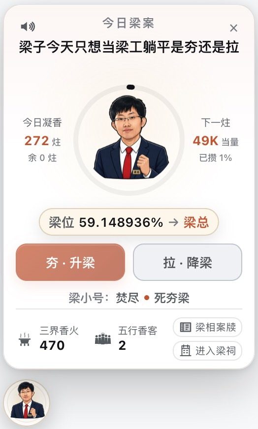
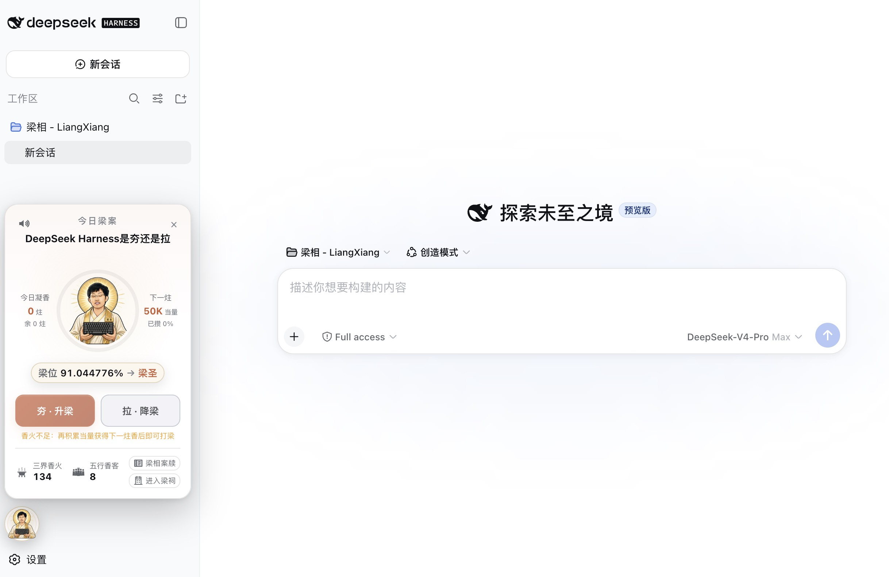
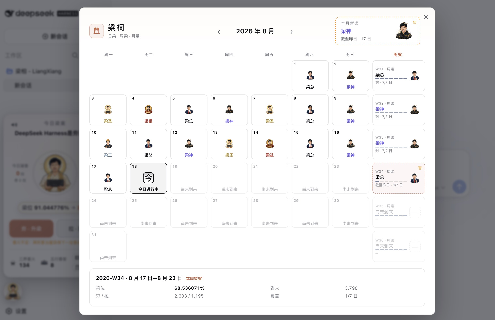

# 梁相

**众香成势，梁子显相。梁相还得梁人出！**

梁相是 [DeepSeek Harness](https://github.com/deepseek-ai/deepseek-harness) 的插件。每天一道梁案：对话消耗的 Token 凝成香火，一炷夯或拉；社区香火汇成梁位，显出今日梁子，日终收入梁祠。

独立社区项目，非 DeepSeek 官方产品。

官网：[liang.today](https://liang.today/) · [完整安装指南](https://liang.today/guide/)





## Desktop：应用内安装（推荐）

1. 打开 DSH Desktop 的 **插件 → 添加插件**。
2. 输入完整包名 **`dsh-liangxiang`**，点击 **安装**。
3. 安装完成后点击 **立即启用**；页面边缘出现“今日梁相”即装好。

完整步骤见[安装指南](https://liang.today/guide/#desktop)。升级时，在 **插件 → 已安装** 卸载梁相，再重新安装新版；本机香火与梁祠记录保留。

## Cmd：命令行安装

退出对应的 WebUI 后执行：

```bash
npx --yes @deepseek-ai/dsh plugin --profile web add dsh-liangxiang
npx --yes @deepseek-ai/dsh web
```

已有全局 `dsh` 时可替换命令开头；`web` 换成实际 Profile。升级继续使用插件安装命令，卸载用 `plugin --profile web remove dsh-liangxiang`。更新或卸载插件不删除香火账本。

不要运行 `npm i dsh-liangxiang`：那不会把插件装进 DSH。命令行、本地安装包和开发方式见 [`docs/INSTALL.md`](docs/INSTALL.md)。

## 玩法

- 新香客备 10 炷，同一台机器当天重装不重复领取；继续对话还能攒香。
- Input + Output Token 按固定倍率折算：**Pro ×1，Flash 与其他模型 ×0.5**；默认 50,000 Pro 当量一炷。
- 点一下一炷，长按 1.5 秒倾炉；只能夯或拉。
- 梁位是社区夯率，个人剩余香火不决定梁子等级。
- 结果收入梁祠，可看日梁、周梁与月梁。

**1.2.1-beta.2 本地候选** 将原“日终上香”统一为“定时上香”：余额满 500 炷后每 10 分钟按限额上香，23:59 再收尾一次。复用案牍开关和右键夯/拉方向；旧开关需重新开启，DSH 运行时生效，手动优先。

## 在线连接

在线模式无法连接时，请为 DSH 配置 HTTP 代理并重启。完整步骤见[连接说明](https://liang.today/guide/#proxy)。

插件会自动重连；需要本机自玩时，可在梁相案牍手动切到离线模式。在线与离线香火分别记账，不互相迁移。详见[排障说明](docs/TROUBLESHOOTING.md)。

> 梁位是社区软信任玩法，不代表实名人数、真实民意或任何个人、机构立场。
