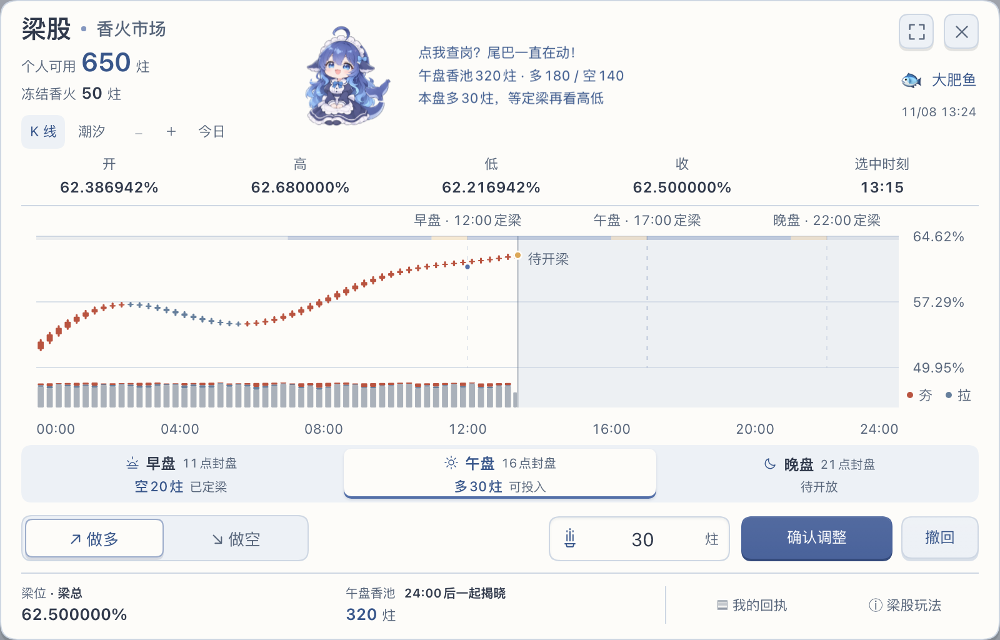
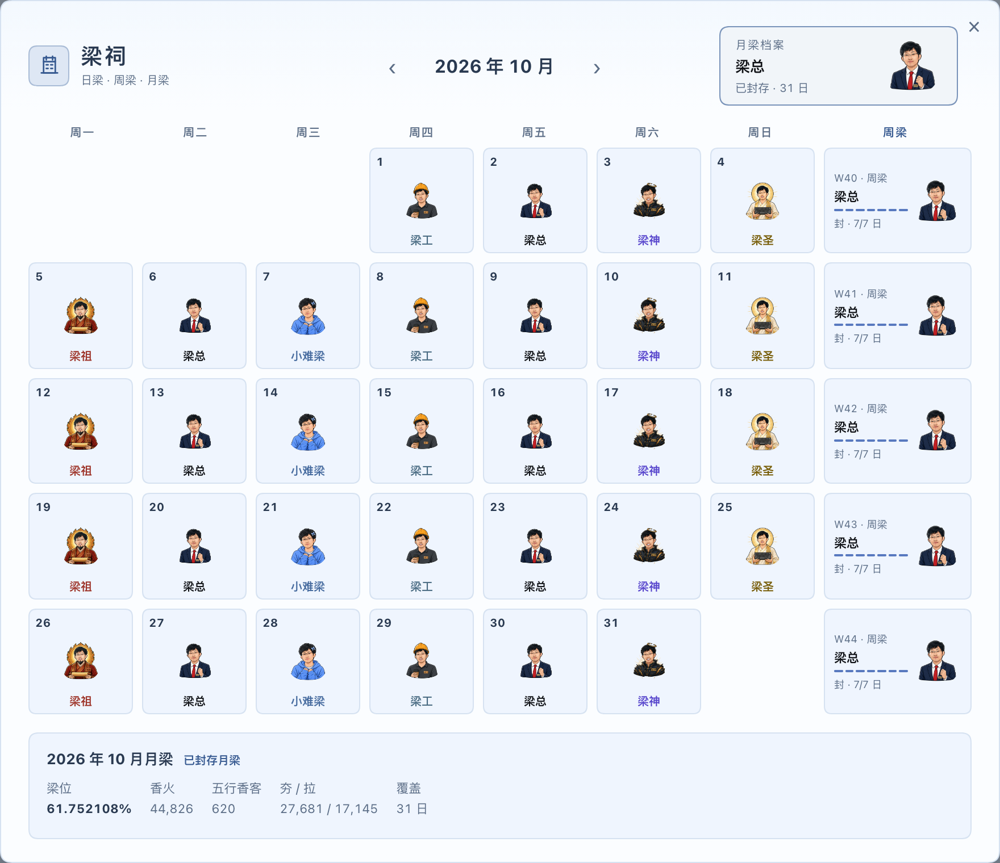

# 梁相

**在大A受的伤，让梁股为你抚平。**

梁股开盘了！梁相是[DeepSeek Harness](https://github.com/deepseek-ai/deepseek-harness)的社区插件。对话攒香火，夯拉定梁位；早午晚三盘做多做空，K线和潮汐看实时行情，午夜一起揭晓。在线香火与收益跨日保留，明天接着玩。

[官网](https://liang.today/) · [安装指南](https://liang.today/guide/) · [源码](https://github.com/liang-today/dsh-liangxiang)

## 香火能攒了，梁股开盘了

- **梁股三盘**：早、午、晚独立选多空；封盘前可改可撤，午夜统一结算，投入、撤回和到账都有轻声回应。
- **实时行情**：K线、潮汐随你切换，梁位、持仓与回执集中看。
- **在线钱包**：香火收益，跨日保留。可用、冻结分开看。
- **全新水景**：余香化水、游鱼相伴；熟悉的拍梁子、凝香和倾炉都在。





*功能示例，香火数据仅作演示。*

## 梁股怎么玩

点主面板的**梁股**，看K线或潮汐，选一盘投入整炷香火：觉得午夜梁位会高于本盘参考梁位，就做多；觉得会低，就做空。投入先冻结，封盘前能改方向、改金额或撤回。

| 盘次 | 可投入、修改和撤回 | 定梁时刻 |
| --- | --- | --- |
| 早盘 | 07:00–11:00 | 12:00 |
| 午盘 | 12:00–16:00 | 17:00 |
| 晚盘 | 17:00–21:00 | 22:00 |

北京时间，以盘面时间为准。三盘可独立选方向，午夜一起结算：赢家按投入比例分对面香火，输家失去本盘投入；持平、单边或场次取消则退款。结果在**我的回执**查看，结算不需要客户端在线。

## Desktop（推荐）

在DSH中打开 **插件 → 添加插件**，输入 **`dsh-liangxiang`**，点击 **安装 → 立即启用**。完整步骤见[安装指南](https://liang.today/guide/#desktop)。本页右侧的 `npm i dsh-liangxiang` 只安装普通依赖，不会把插件加入DSH；请使用应用内入口或下面的插件命令。

**升级**：DSH0.2.2-rc.1等支持原生更新的版本，优先在梁相详情的 **版本** 区按提示更新；0.2.1-rc.2等旧入口或没有更新入口时，卸载梁相插件再安装新版。保留DSH数据目录，继续使用原身份和记录；完成后在 **梁相案牍 → 当前版本** 核对版本。原生更新的适用条件见[DSH官方说明](https://github.com/deepseek-ai/deepseek-harness/blob/66491b05e3f05ad35bcdd4f6cd7ed26041d9e3db/packages/client/ui-plugin-manager/README.zh.md#更新注册表组合包)。

## Cmd

命令行采用当前DSH0.2.2时需Node24.9及以上；Desktop使用内置运行环境。

退出对应 WebUI，再安装并启动：

```bash
npx --yes @deepseek-ai/dsh plugin --profile web add dsh-liangxiang
npx --yes @deepseek-ai/dsh web
```

已有全局 `dsh` 时可替换开头；`web` 换成实际 Profile。升级使用插件安装命令；卸载使用 `plugin --profile web remove dsh-liangxiang`。香火账本不随卸载删除。

## 日常玩法

每天一道梁案，符合资格时每日备10炷，同设备当天重装不重复领取；对话继续攒香。Input + Output Token按固定倍率折算：**Pro ×1，Flash与其他模型 ×0.5**，默认50,000 Pro当量一炷。点一下一炷夯或拉，长按1.5秒倾炉；众香汇成梁位，日终收入梁祠。

- **香火环**：看剩余香火和下一炷进度；个人余香与全社区梁位分别展示。
- **定时上香**：默认关闭，在案牍开启，右击夯／拉设置方向。满500炷后等10分钟尝试倾炉，23:59再尝试收尾；需DSH保持运行。
- **梁祠**：按日、周、月回看梁子与社区香火，今天进行中的梁案单独标记。
- **日常交互**：入口可拖动，拍梁子有小彩蛋；案牍能切换在线／离线、重看版本说明，广播台带来重要消息。梁股动效可切静态，音量可调也可静音。

## 从旧版升级

首次启用2.0在线钱包只承接当天实际余香与进度，不补历史过期余额。此后余额与已到账收益跨日保留；同一身份请保持使用2.0及以上版本，避免混用旧客户端。尚未升级的1.2用户继续原日账玩法。在线与离线香火分开，不合并。

## 连接与社群

在线连接会自动重试，网络中断不会自动切到离线。无法连接时，可为DSH配置HTTP代理并重启。设置步骤见[连接说明](https://liang.today/guide/#proxy)。离线模式可直接在本机游玩，香火与社区分别记账。

来 **QQ群453683905** 一起出梁案、晒梁位，和梁友聊聊下一次开盘。

独立社区项目，非 DeepSeek 官方产品。香火只用于插件内游玩，不兑换现金；梁位不代表实名人数、真实民意或任何个人、机构立场。
